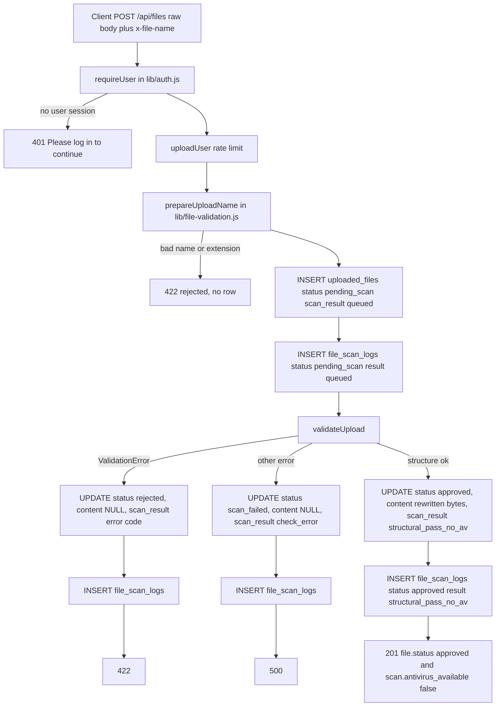

# Upload lifecycle

This is the path for `POST /api/files`. A profile photo is a different path: `PUT /api/profile` stores a data URL on `users.avatar_url` and never writes `uploaded_files`.

There is no antivirus engine. Approval means the file passed structural checks only. This is a temporary risk decision, not a completed control. See the end of this document.

## Diagram

## Steps

| Step | Who | What changes |
| --- | --- | --- |
| 1. Request | Caller | `POST /api/files`, raw body, header `x-file-name`. Multipart is refused with 415. Empty body is 400. |
| 2. Session | `requireUser` (`lib/auth.js`) | No table write. Missing session returns 401. |
| 3. Rate limit | `uploadUser` (`lib/rate-limit.js`) | No file row. |
| 4. Name check | `prepareUploadName` (`lib/file-validation.js`) | Allowed extensions: jpg, jpeg, png, webp, pdf. Failure is 422 `status=rejected` and no database row. |
| 5. Store as pending | `router.post('/')` in `routes/files.js` | `uploaded_files`: `id` (UUID), `owner_id`, `original_name`, `storage_key` (`{id}.{ext}`), `extension`, `mime_type`, `size_bytes`, `content` (original bytes), `status='pending_scan'`, `scan_result='queued'`. Then `file_scan_logs`: `status='pending_scan'`, `result='queued'`. |
| 6. Structural check | `validateUpload` (`lib/file-validation.js`) | Size at most 2 MB. Magic bytes must match the extension. Images are decoded and re-encoded (max 2048 px). PDFs are parsed and rewritten (1 to 50 pages). Success value is `scanResult='structural_pass_no_av'`. |
| 7a. Approve | Same request handler | `UPDATE uploaded_files` only while `status='pending_scan'` and `owner_id` matches: `content` = rewritten bytes, `extension`, `mime_type`, `size_bytes`, `status='approved'`, `scan_result='structural_pass_no_av'`, `scan_checked_at=now()`. `file_scan_logs` gets `status='approved'`, `result='structural_pass_no_av'`. Response 201 includes `scan.antivirus_available=false`. |
| 7b. Reject | Same handler on `ValidationError` | `content=NULL`, `status='rejected'`, `scan_result` = the validation code (`unknown_signature`, `signature_mismatch`, `file_too_large`, `image_parse_failed`, `pdf_parse_failed`, and the other `ValidationError` codes). HTTP 422. |
| 7c. Check failed | Same handler on any other error | `content=NULL`, `status='scan_failed'`, `scan_result='check_error'`. HTTP 500. The status value `scan_failed` is only the column's existing state name. `check_error` means the structural check threw. Neither value is an antivirus verdict. |
| 8. Download | `GET /api/files/:id/download` | Owner only. Sends bytes only when `status='approved'` and `content` is present. Otherwise 409. |

Nothing else updates `uploaded_files.status`. There is no worker, queue, or admin action that approves a file later. The same HTTP request that inserted `pending_scan` either approves it, rejects it, or marks `scan_failed` before the response is sent.

## What moves `pending_scan` to `approved`

`routes/files.js` sets `status='approved'` only after `validateUpload` returns. The basis is:

- filename extension is jpg, png, webp, or pdf
- magic-byte signature matches that extension
- size is 1 byte through 2 MB before and after rewrite
- an image decodes and re-encodes within 2048 by 2048 pixels, or a PDF parses and rewrites with 1 to 50 pages

`scan_result` on that row is `structural_pass_no_av`. That string means the structure check passed. It does not mean antivirus software scanned the file. The JSON field `scan.antivirus_available` is `false`.

## Temporary risk decision

No antivirus engine runs on the Worker or anywhere else in this repository. Structural checks do not detect malware inside a well-formed JPEG, PNG, WebP, or PDF. Shipping this way is a documented temporary risk decision. It is not Done.

Later options:

| Option | What it would do | Privacy trade-off |
| --- | --- | --- |
| ClamAV on a separate server | The Worker would send file bytes to a server you operate. Approval would wait for that server's result. | File contents leave the database host and sit on the scan server for the duration of the scan. You control retention and who can log in. Patients' documents are still copied to a second machine. |
| Scanning API, only with explicit consent | A vendor scans the bytes and returns a verdict before `approved`. The product must ask the user before any upload is sent. | File contents go to the vendor. Their staff, subprocessors, and logs may see the document. Consent has to name that vendor and what is sent. Without that consent, do not call the API. |
